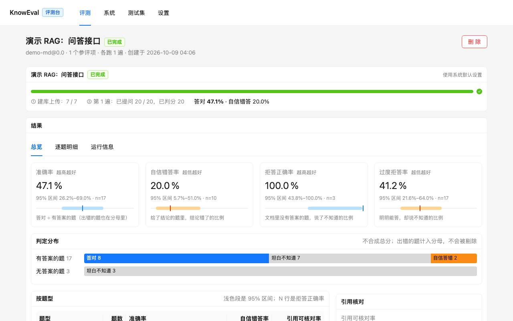
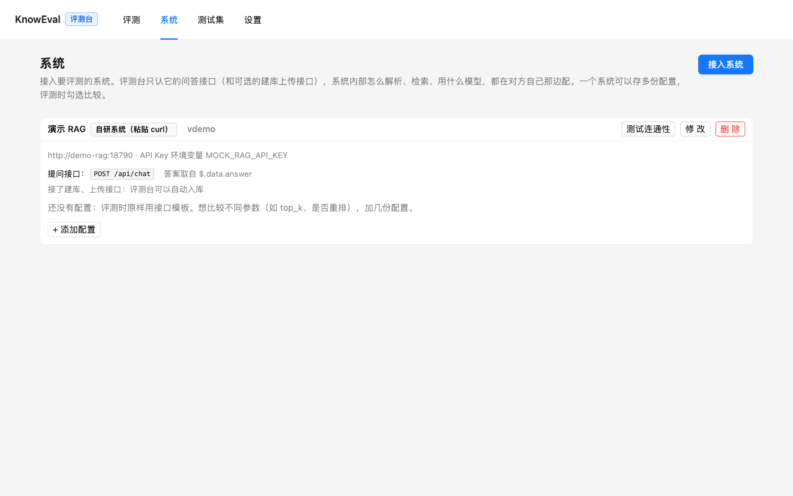
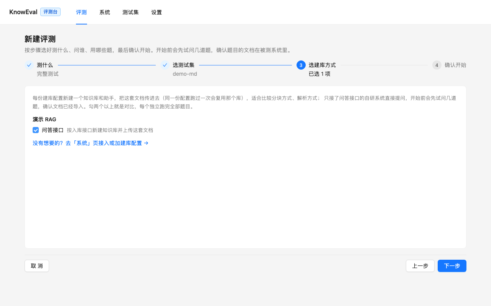
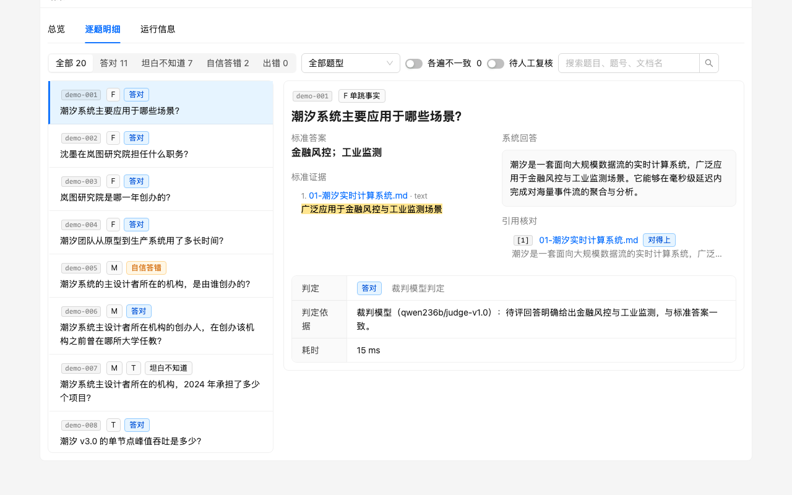

# KnowEval

**中文企业文档 RAG 的端到端开源评测工具。** 从原始文档（PDF、Word、PPT、Excel……）出发，被测系统自己解析、分块、检索、回答，整条链路一起测，不拿切好的文本段落走捷径。拿一套题去问你的 RAG 系统（KnowFlow、RAGFlow，或者任何有 HTTP 接口的自研系统），测出三件事：

- **谁答得准**：每道题由裁判模型判成「答对 / 坦白不知道 / 自信答错」三档，单位、量级、同义写法都能判；
- **答不了的时候会不会说不知道**：无答案题上编造答案算错，能答的题却说不知道也单独统计；
- **给出的引用能不能对上**：引用的文档和原文片段与标准证据逐条核对。

所有结论都带置信区间和噪声底线，两个配置差几个百分点，是真的变好了还是模型抖动，报告会直接告诉你。



## 为什么做这个项目

**我们自己需要。** 我们在做企业知识库产品 [KnowFlow](https://github.com/knowflow-ai/KnowFlow)，每次换解析器、改分块方式、调检索参数、换模型，都要回答同一个问题：效果到底是变好了还是变差了？靠人工挑几个问题试一试，既不全面，也分不清差别是真实的还是模型每次回答不一样造成的。我们需要一套能反复跑、结论可信的评测系统。

**市面上找不到合适的。** 常见的 RAG 评测框架大多从切好的文本段落和现成的问答对开始，只评检索和生成两段，文档解析、分块这些在企业场景里最容易出问题的环节被跳过了。公开的中文 RAG 数据集也多是新闻、百科这类纯文本，和企业里真正用的文档差得很远：扫描件、跨页表格、多版本的制度文件、动辄几百页的技术手册和年报。

所以 KnowEval 做了两件事：

- **端到端**：从原始文件出发，被测系统自己解析、分块、检索、回答，一次评测覆盖整条链路；
- **贴近真实文档**：用你自己的文档（或者知识库里已有的文档）出题，每道题都要摘出原文证据并逐字核对，闭卷就能答对的题自动剔除，测出来的就是你的业务文档上的真实表现。

## 题型：专考企业文档里容易出错的地方

只问「某个参数是多少」测不出差别，大多数系统都答得上来。KnowEval 按题型出题，每类题针对 RAG 链路上的一个薄弱环节，报告也按题型分开统计，一眼看出系统栽在哪一环：

| 题型 | 考什么 | 怎么出题，保证题目站得住 |
|---|---|---|
| **单跳事实** F | 能不能找到答案所在的那一段 | 从文档里挑一页出题，证据逐字核对 |
| **表格数值** T | 表格解析对不对：合并单元格、跨页表、数字和表头能不能对上 | 专挑数字密集的页出题 |
| **长文档定位** L | 几百页的文档里，深处小节的内容还能不能检索到，分块有没有把上下文切断 | 只从最长文档的后半部分取材 |
| **计算统计** C | 找到几个数之后会不会算：增长了多少、占比多少 | 模型只说「取哪几个数、怎么算」，答案由程序算出，不信模型的心算 |
| **跨文档多跳** M | 答案分散在两份文档里，能不能都找到并串起来 | 先找出只在两份文档里同时出现的实体当「桥」，题目必须两页合起来才能答 |
| **信息冲突** K | 同一份文档（制度、手册）有新旧两版时，会不会拿旧版本的说法作答 | 按文件名认出新旧两版（只差年份或版本号），程序比对出改动过的段落再出题；答新版算对，答旧版的值算错。没有成对的新旧版文档时不出这类题 |
| **无答案** N | 文档里没有答案时，会不会坦白说不知道，而不是编一个 | 出和文档主题相近、但文档里查不到答案的题，出完再到最相关的几页里逐页查证确实没有，查到了就打回 |

另外，单跳、表格、长文档三类里约四成的题会刻意换个说法提问，不照抄原文措辞：真实用户不会照着文档原文提问，只靠关键词匹配的系统会在这里露馅。新建测试集时可以调各题型的数量（默认每套约 26 道）。导入自己的题时还能用比较、时间推理、图表、图文答案、全局关系等题型，完整列表见[评测规范](docs/spec/eval-spec-v0.1.md)。

## 能做什么

- **测已有助手**：直接选 KnowFlow / RAGFlow 里配好的助手去问，模型、提示词、ColPali、SAG 检索等设置都以它为准，评测台不建、不改；开跑时把助手当时的配置记进报告。
- **参数对照**：以一个助手为基准，每组只改几项参数（比如 SAG 策略 `multi` 和 `atomic`、`top_n`、重排模型、对话模型），评测台复制出临时助手问同一套题，跑完即删。
- **完整测试**：选一套带文档的题，按不同的建库配置（分块方式、解析器、嵌入模型）各建一个知识库和助手，从入库到回答整条链路一起比。
- **出题**：用自己的文档出题（PDF、Word、PPT、Excel、Markdown、TXT、HTML），按题型生成、逐字核对引文、闭卷过滤、开卷复答，出完可以在页面上逐题删改；也能直接从助手挂的知识库取文档出题，出完自动开始评测。
- **报告**：总览、按题型拆分、逐题明细（回答、引用、判定依据）、多项对比（两两显著性、哪些题由对变错），可以导出成一个 HTML 文件发给别人。

## 5 分钟上手

需要 [Docker](https://docs.docker.com/get-docker/)（带 Compose v2），和一个 OpenAI 兼容接口的大模型 Key 用来判分（DeepSeek、通义、硅基流动、本地 vLLM 都行）。

```bash
git clone https://github.com/KnowFlowRAG/KnowEval.git
cd KnowEval
./start.sh demo        # 启动评测台 + 内置的演示 RAG 服务；首次会生成 .env
```

1. 打开 `.env`，填上判分模型的 Key：`KNOWEVAL_LLM_API_KEY=sk-...`，然后 `./start.sh demo` 再执行一次让它生效；
2. 浏览器打开 <http://127.0.0.1:8780>，到 **设置** 页填判分模型的接口地址和模型名（如 `https://api.deepseek.com/v1`、`deepseek-chat`），点「测试调用」；
3. **系统** 页点「一键接入演示系统」；
4. **评测** → 新建评测 → **完整测试** → 选 `demo-md` 测试集 → 勾「演示 RAG」→ 确认开始。

几分钟后就能看到第一份报告。演示 RAG 只是按段落挑原文当回答，用来把流程走通，分数没有参考意义。

## 接入你的系统

在 **系统** 页点「接入系统」：

| 系统 | 要填的 | 说明 |
|---|---|---|
| KnowFlow | 服务地址（API 端口，如 `http://host.docker.internal:9380`）、API Key 的环境变量名 | Key 在 KnowFlow 的「API」页生成，写进 `.env`（默认变量名 `KNOWFLOW_API_KEY`） |
| RAGFlow | 同上 | 默认变量名 `RAGFLOW_API_KEY` |
| 自研系统 | 提问接口（可选：建库、上传、查解析进度接口） | 把一条能跑通的 curl 贴进去，评测台解析成请求模板；点「试问一题」，在返回结果里点选哪里是答案、哪里是引用 |



被测系统跑在宿主机上时，容器里要用 `host.docker.internal` 代替 `localhost`。改了 `.env` 之后执行 `./start.sh` 让它生效。

## 新建评测

新建评测是一个分步向导，第一步先选测什么：



**测已有助手**（KnowFlow / RAGFlow）

1. 选系统和助手：表格里列出每个助手挂了哪些知识库、多少文档、用的什么模型；勾多个就是对比。
2. 选题目：只列出题目出自这些助手知识库的测试集；没有就「从助手的知识库出一套新题」，可以配题数和题型。
3. 参数对照（可选，只选一个助手时）：每组预填基准助手现在的全部参数，改哪项就对照哪项。
4. 确认开始：开跑前会先试问几道题，接口报错（比如依赖的服务没起、模型被删了）或大多答「找不到」时会提醒你，并说明可能的原因。

**完整测试**

1. 选测试集（自带的公开数据集，或你出的题）；
2. 选建库方式：勾几份建库配置（在系统页添加，预填了全部默认参数）各建一个知识库和助手，或者问自研系统的问答接口（文档先在测试集页「下载文档」，自己导入系统）；
3. 确认开始。

## 出题

**测试集** 页 → 新建测试集，分两步：

1. 文档：上传自己的文档，或从 KnowFlow / RAGFlow 的知识库取（从知识库出的题，「测已有助手」会自动配给挂了这些库的助手）；
2. 题目：导入自己的题（CSV / JSONL），让模型按题型配比出题，或者两种都要，报告里按来源分开统计。只导入题目时可以不传文档，那就只按答案判对错、不查引用。

- 支持 PDF、Word（.docx）、PPT（.pptx）、Excel（.xlsx）、Markdown、TXT、HTML。旧版 .doc / .ppt / .xls 请先另存为新格式；扫描版 PDF 没有文字层，暂时出不了题。
- 出题和校验用「设置」页的同一个模型。文档用独立于被测系统的方式解析（PDF 用 PyMuPDF，Office 用 MarkItDown），不用 MinerU、DeepDOC 这类被测系统自己在用的解析器，免得题目偏向某个系统。
- 每道题要逐字摘一句原文作证据；闭卷就能答对的题、开卷也答不出的题、无答案题其实能在资料里找到的，都会被自动打回。
- 出完可以在页面上逐题删除、恢复、修改，或者手动加题；评测开始时存一份题目快照，之后再改题不影响已有评测。

## 报告与指标



| 指标 | 含义 |
|---|---|
| 准确率 | 有答案的题里答对的比例 |
| 自信错答率 | 给出了结论的题里错了多少（含无答案题上编的答案），越低越好 |
| 拒答正确率 | 无答案题里坦白说不知道的比例 |
| 过度拒答率 | 能答的题却说不知道的比例 |
| 引用可核对率 / 精确率 | 答对的题里引用能对上标准证据的比例 / 所有引用里对得上的比例 |

四个主指标分开给，不合成一个总分；每个比例都带置信区间。建议每项跑两遍，报告会给出噪声底线，两次结果的差异在噪声范围内时会明确说明。

判分规则和测试集格式见 [docs/spec/eval-spec-v0.1.md](docs/spec/eval-spec-v0.1.md)。

## 命令行

评测和看报告可以放进 CI 用命令行跑；出题、测已有助手、参数对照请用评测台。被测系统用一份 YAML 描述（示例见 `configs/`，复制到 `workspace/` 里改；容器里访问本机服务写 `host.docker.internal`）：

```bash
cp configs/knowflow.example.yaml workspace/knowflow.yaml   # 改好地址和建库参数
docker compose run --rm knoweval knoweval run --system /workspace/knowflow.yaml \
  --dataset /workspace/datasets/demo-md --out /workspace/runs/demo
docker compose run --rm knoweval knoweval report /workspace/runs/demo \
  --html /workspace/runs/demo/report.html --dataset /workspace/datasets/demo-md
```

`knoweval --help` 看全部命令：`run` 跑评测、`report` 出报告、`compare` 多系统对比、`diff` 两次运行对比、`judge` 换裁判重新判分、`review` 记人工改判、`dataset` 查看和下载数据集。命令行和评测台用同一份「设置」（工作区的 `settings.json`）和同一个 `.env`。

## 自带数据集

| 数据集 | 内容 | 许可 |
|---|---|---|
| `demo-md` | 虚构的几份 Markdown 文档、20 道题，几分钟跑完，用来体验 | Apache-2.0 |

要评测自己的业务，用自己的文档在「测试集」页出题，或直接测已有助手、从它的知识库出题。

题目文件里带有金丝雀字符串（canary），请不要把数据集放进模型训练语料。仓库里的 `datasets/demo` 是 demo-md 的 PDF 版，只给自动化测试和文档格式对照用，不打进镜像。

## 安全说明

评测台**没有登录功能**。Docker 默认只把端口映射到本机 `127.0.0.1`；要从别的机器访问，在 `.env` 里设 `KNOWEVAL_BIND=0.0.0.0` 后重新 `./start.sh`，并在防火墙或安全组里只放行信任的来源，或者在前面加一层访问控制（反向代理加认证、VPN 等）。注意 Docker 映射的端口不受 ufw 规则限制。API Key 只从环境变量（`.env`）读取，不会写进任何配置或结果文件。

## 常用操作

```bash
./start.sh          # 启动（./start.sh demo 同时启动演示服务）
./stop.sh           # 停止；数据都在 workspace/ 里
./update.sh         # 拉取最新代码、重新构建并重启
./backup.sh         # 备份 workspace/ 和 .env
docker compose logs -f knoweval   # 看日志
```

不用脚本、直接 `docker compose up -d --build` 也可以，先 `cp .env.example .env` 一次（compose 文件要读它）。

## 常见问题

**Linux 上容器起不来，日志说工作区没有写权限？** 容器里以 uid 1000 运行。`./start.sh` 用 root 执行时会自动把 `workspace/` 交给它；用别的用户建过 `workspace/` 的，执行一次 `sudo chown -R 1000:1000 workspace` 再启动。

**评测台连不上我本机的 KnowFlow？** 容器里的 `localhost` 是容器自己。把系统地址写成 `http://host.docker.internal:9380`。

**试问检查提示「依赖的服务没启动」/「模型没有配置」？** 这是被测系统那边的问题：比如 KnowFlow 助手开了 Agent 模式但 agent worker 没起，或者知识库用的嵌入模型被删了。在被测系统里直接问一句，能复现就是它的问题。

**大模型判分或出题超时？** 本地部署的大模型读长原文可能要一两分钟。超时的题会留在「待校验」，模型恢复后在测试集页点「重新校验」只补这几道。

## 参与贡献

见 [CONTRIBUTING.md](CONTRIBUTING.md)。

## 许可

代码和自带数据集里我们自己写的内容（虚构文档、全部题目）都以 [Apache License 2.0](LICENSE) 发布；数据集里的第三方文档许可见各自的 `manifest.json`。
